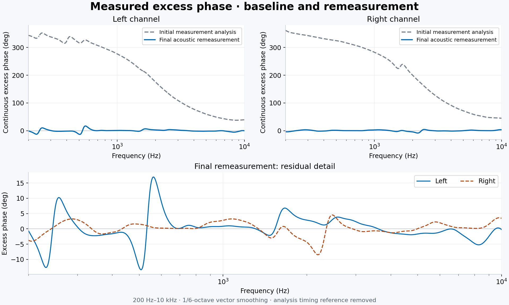
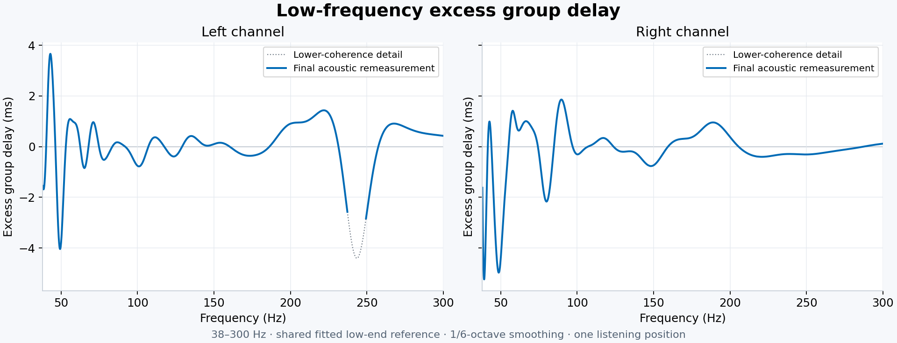
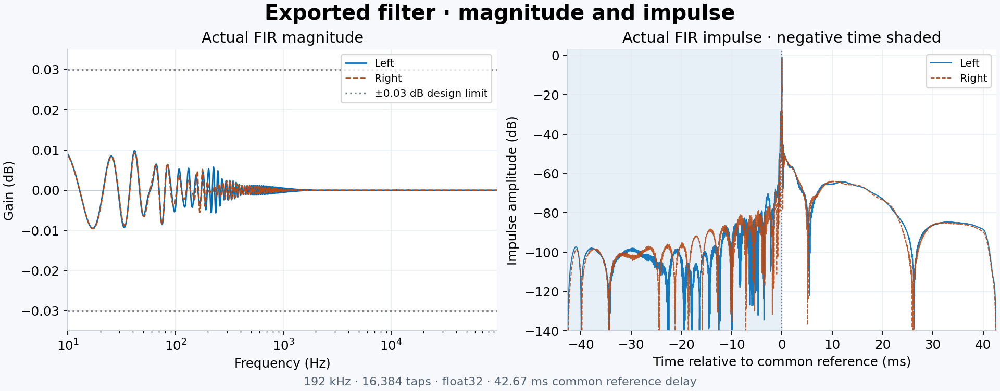

# REW 剩余相位 FIR · v2

[English](README.md) | 简体中文

本地 REW 剩余相位分析与近全通 FIR 生成工具，也可作为 Codex Skill 使用。支持立体声、未知分频、多分频、环绕声配对及独立声道，低音炮需事先完成系统对齐。作者：**Winter-Ignition**。

**启用 FIR 后，必须重新测量并重新校准频响，已有频响 EQ 也一样。** 保留必要分频、保护和系统物理延迟。测未校准基线时，关闭待替换的混合相位或剩余相位校正。

## 功能

- 从原生 IR 或密集幅度/总相位导出计算剩余相位，默认 1/6 倍频程复数矢量平滑，检查换圈与窗口敏感度。
- 分别记录音箱最低不失真频率、测量非噪声主导的低频下限；下限以下不参与拟合，以等效高通延伸计算最小相位，并记录候选模型敏感度。
- 从有效下限到 10 kHz 统一校准宽带相位；较快的局部群延时细节只处理至 300 Hz 或更低的头部移动估计上限，该局部上限不限制宽带整体校准。
- 各声道独立拟合。10 kHz 以上共同校准量平滑接回，配对差分优先缩小接近 10 kHz 的左右差异，不把整个极高频剩余相位归零。
- 支持旧 FIR 启用后的复测重做：核对旧系数、哈希、声道与公共延迟，输出一份完整替换滤波，避免重复叠加。
- 默认 192 kHz、16384 点、float32 WAV、42.67 ms 公共参考延迟；独立回读实际系数检查增益、前振铃能量、衔接、组合与对称，并用直接 DTFT 抽查。
- 输出离线 HTML、PNG、CSV、manifest 与验收结果。复测比较冻结低端参考形状和原平滑规约。

## 实测示例

以下是一套立体声音箱在听音位的真实测量，采用 1/6 倍频程矢量平滑，仅在分析中去除时间参考差。灰色虚线来自保留的初始测量分析，蓝线是最终声学复测，不是预测。下方放大图展示校准后仍然存在的相位起伏。



低频参考在处理过程中经过调整，因此下图单独展示最终复测，不与初始低频作精确对比。计算使用拟合的低端参考，点线段表示矢量一致性较低；房间相关结构和测量噪声仍保留在图中。



这份滤波的实际 float32 系数增益误差约在 ±0.011 dB 内。脉冲图展示公共参考时间两侧的能量，包括提前能量。



## 环境与运行

Python 3.10+，NumPy ≥1.24、SciPy ≥1.10、SoundFile ≥0.12、Matplotlib ≥3.7。卷积器需支持导出的格式与声道布局。

```bash
python -m venv .venv
# 激活环境后运行：
python -m pip install -r requirements.txt
python scripts/phase_fir.py inspect left.txt right.txt
python scripts/phase_fir.py design request.json --out design-run
python scripts/phase_fir.py verify design-run
python scripts/phase_fir.py compare remeasure.json --reference design-run --out remeasure-run
python -m unittest discover -s scripts -p "test_*.py"
```

每次生成使用新目录。参数见[命令与配置](references/commands.md)，输入见[测量与导出](references/measurement.md)，方法见[算法与验收](references/algorithm.md)。Skill 安装时，将 `SKILL.md`、`agents/`、`references/`、`scripts/`、`requirements.txt` 放进技能目录中的 `rew-excess-phase-fir/`。

## 使用边界

有限 FIR 只能近似全通；可用延迟和提前能量限制能补偿的结构，深陷波和不稳定相位保守处理。低端拟合是等效参考，不代表识别出真实箱体阶数。噪声下限未知时，低频绝对剩余相位未认证。完整导出不等于全部频点可信；超声由噪声主导的 FRD 会明确采用可听带分析参考。

“应用后”曲线在复测前只是预测。逐频带看相位与群延时，不能用相位 RMS 下降代替全部峰谷验收。单点测量不能证明整个头动范围稳定。本工具不调真实声道到达延迟或低音管理；分别移动过 IR 的测量也不能恢复真实左右延迟。

每个逻辑输入只加载一次完整文件。替换文件已包含旧滤波一次，且只保留一份公共延迟，启用时移除旧文件。同一输入的低音管理支路须共用校准；留出共同数字余量，避免音乐峰值削波。

## 版本与数据

[v1 保留下载](https://github.com/Winter-Ignition/rew-excess-phase-fir/releases/tag/v1)。v2 改善高频衔接，并加入噪声下限建模和完整替换流程。v2 的清单与分析文件配套使用；v1 WAV 可作为明确映射的旧滤波输入，v1 报告不能冒充 v2 冻结参考包。

脚本不联网、不上传测量、不改音频设备设置。仓库不包含个人原始测量；README 中的测量和滤波图片经所有者授权，已移除识别信息，源文件与分析记录仍保留在本地。个人测量、报告和滤波放在仓库外，或本地已忽略目录。

## 许可

[MIT](LICENSE)，Winter-Ignition。公开参考来源与方法边界列在算法文档。
